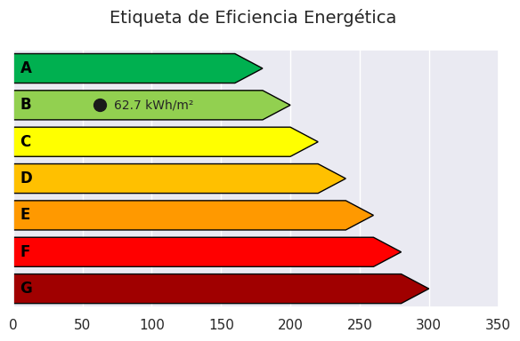
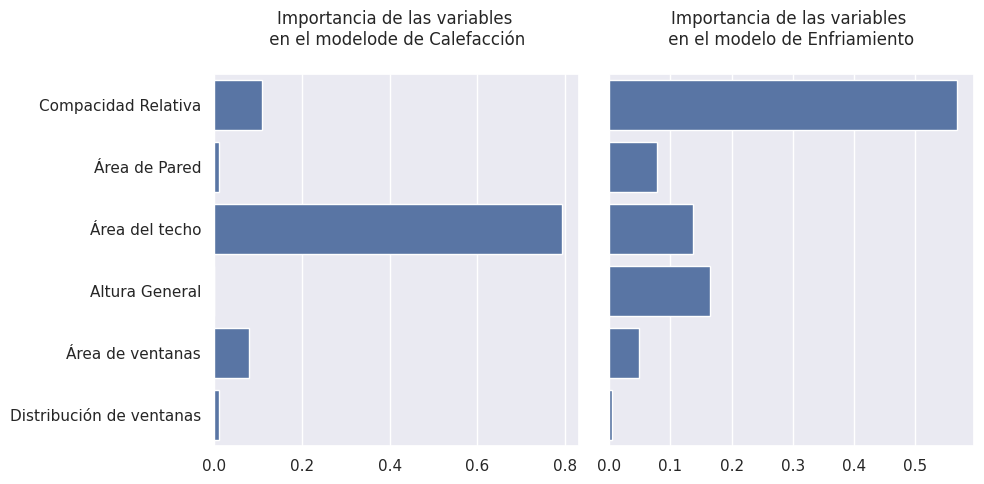

# Predicción y Clasificación de la Eficiencia Energética en Edificios

Modelo de Machine Learning que predice la **carga de calefacción y enfriamiento** de edificios residenciales a partir de su diseño arquitectónico y los clasifica con una **etiqueta energética A–G**, como base técnica para una certificación energética antes de construir.



## Problema
No existe una herramienta que relacione el diseño de un edificio (compacidad, áreas, altura, ventanas) con su **demanda energética térmica**. Sin ella, no se puede clasificar su eficiencia antes de construirlo ni diseñar normativas de construcción sostenible.

## Datos
- **Fuente:** [Energy Efficiency Dataset – UCI Machine Learning Repository](https://archive.ics.uci.edu/dataset/242/energy+efficiency)
- **Volumen:** 768 edificios simulados, 8 variables de diseño y 2 salidas (carga de calefacción y de enfriamiento, en kWh/m²), sin nulos
- **Metodología:** CRISP-DM

## Resultados (conjunto de prueba, 20 %)

| Salida | Mejor modelo | R² ajustado | RMSE | MAE | Error relativo* |
|---|---|---:|---:|---:|---:|
| **Calefacción** | Decision Tree | **0.997** | 0.52 | 0.38 | **1.7 %** |
| **Enfriamiento** | Random Forest | **0.959** | 1.92 | 1.27 | **5.2 %** |

\* MAE respecto a la carga promedio (22.3 y 24.6 kWh/m²).

**Validación Leave-One-Out (9 modelos comparados)**

| Modelo | R² ajustado (Calefacción) | R² ajustado (Enfriamiento) |
|---|---:|---:|
| Decision Tree | 0.998 | 0.968 |
| Random Forest | 0.998 | 0.968 |
| Gradient Boosting | 0.998 | 0.968 |
| KNN | 0.994 | 0.962 |
| AdaBoost | 0.966 | 0.934 |
| SVR | 0.941 | 0.906 |
| Regresión Lineal | 0.922 | 0.887 |
| Ridge | 0.922 | 0.886 |
| Lasso | 0.887 | 0.848 |

**Conclusiones clave**
- Los modelos de **árboles** (Decision Tree, Random Forest y Gradient Boosting) superan claramente a los lineales: el R² ajustado sube de 0.92 a 0.998 en calefacción.
- El **Área del techo** domina la calefacción (79 % de importancia) y la **Compacidad relativa** domina el enfriamiento (57 %).
- En la preparación se eliminaron **Superficie** (colinealidad extrema, VIF = ∞) y **Orientación** (no influye en las cargas), y se **binarizó** la distribución de ventanas.



## Metodología
1. **EDA:** distribuciones, outliers, correlaciones y gráfico de pares.
2. **Preparación:** análisis de colinealidad con **VIF**, eliminación de variables, binarización y estandarización.
3. **Modelado:** Regresión Lineal (interpretación de coeficientes) y comparación de 9 algoritmos con validación **Leave-One-Out**.
4. **Evaluación:** R² ajustado, MSE, RMSE y MAE en un conjunto de prueba, más la importancia de variables.
5. **Aplicación:** función que predice ambas cargas y genera la **etiqueta energética A–G** de un edificio nuevo.

## Herramientas
Python · Pandas · NumPy · Scikit-learn · Statsmodels · Matplotlib · Seaborn

## Estructura
```
├── notebooks/
│   └── energy_efficiency_prediction.ipynb
├── reports/
│   ├── figures/              # gráficos del análisis
│   ├── test_results.csv
│   └── loo_results.csv
└── requirements.txt
```

## Cómo ejecutarlo
1. Abre `notebooks/energy_efficiency_prediction.ipynb` en Google Colab o Jupyter.
2. Instala las dependencias con `pip install -r requirements.txt`.
3. El notebook descarga el dataset desde UCI automáticamente. También puedes poner `ENB2012_data.xlsx` junto al notebook.

---
**Diego Yeferson Quispe Huamani** · Estudiante de Big Data y Ciencia de Datos – Tecsup
[LinkedIn](https://www.linkedin.com/in/di-yeferson) · [GitHub](https://github.com/di-yeferson)
